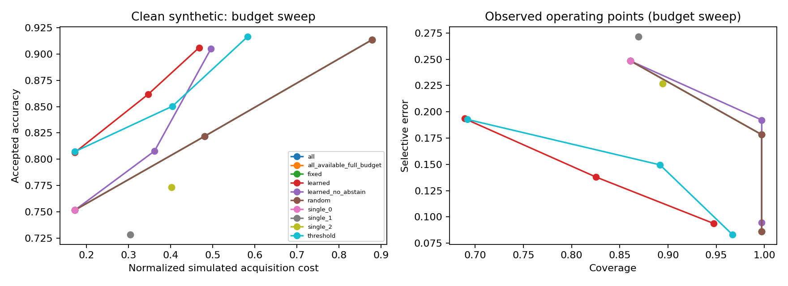

# Selective Multimodal

**Selective Multimodal is a Python and PyTorch pipeline that classifies numerical inputs representing text, audio, and vision, then learns which inputs to request before answering.** A classifier produces the prediction; a second neural network decides whether to collect more evidence, stop, or abstain. Every input has a cost. The system must stay within its budget.

It works with feature vectors, the numerical summaries that machine-learning models process. Three types of input, or modalities, arrive in NPZ files alongside a mask identifying what's available. The included experiment generates synthetic vectors and binary labels, so you can train and run the whole pipeline on a CPU.

Inside the classifier, each acquired vector passes through two linear layers with ReLU activations. The resulting embeddings are concatenated with an observed-input mask and fed to a classification head. Inputs that haven't been acquired contribute zeros; their projection networks never run.

The acquisition network is a separate multilayer perceptron. It receives those embeddings, input availability, costs, and the remaining budget, then chooses among five actions: acquire text, acquire audio, acquire vision, predict, or abstain. Illegal actions are masked out. It can't request a missing input, buy the same input twice, or spend beyond the budget.

Inference starts by charging for the configured first input. From there, the classifier updates its probabilities and the acquisition network chooses what happens next. One example may need text alone; another may prompt an audio request before the system answers. The output records the complete sequence, with costs, probabilities, and a stopping reason.

Training starts with cross-entropy on randomly masked input subsets. Once that classifier is frozen, dynamic programming builds action targets on a separate training partition by comparing classification loss, further acquisition costs, and an abstention penalty. The acquisition network learns these targets through supervised training. Validation data selects the classifier and fits temperature scaling; test labels stay out of both steps.

NumPy handles arrays, scikit-learn computes metrics, and matplotlib draws the reports. The CLI covers generation, training, evaluation, checkpoint loading, and individual predictions. Saved runs compare the learned network with simpler acquisition strategies across three seeds.

## Install

Use Python 3.11+ and CPU PyTorch. From this directory:

```bash
python -m venv .venv
# Windows: .venv\Scripts\activate
# Linux/macOS: source .venv/bin/activate
python -m pip install -e ".[dev]"
```

For the saved experiment's package versions, run `python -m pip install -r requirements-experiment.txt -e .`. The delivered H: directory already has a `.venv`; its interpreter is `.\.venv\Scripts\python.exe`.

The staging copy used `.deps` when virtual-environment setup failed. If you're working from that copy, these commands expose its local dependencies:

```powershell
$env:PYTHONPATH="$PWD\.deps;$PWD\src"
python -m pytest -q --basetemp .pytest-tmp-local
```

## Run the experiment

Run one experiment, reproduce all three seeds, or check the tests:

```bash
python -m selective_multimodal.cli reproduce --config configs/synthetic.yaml
python scripts/reproduce_synthetic.py --seeds 7 11 19
python -m pytest -q
```

Each stage is also available separately:

```bash
python -m selective_multimodal.cli make-synthetic --config configs/synthetic.yaml
python -m selective_multimodal.cli train-predictor --config configs/synthetic.yaml
python -m selective_multimodal.cli train-policy --config configs/synthetic.yaml
python -m selective_multimodal.cli evaluate --config configs/synthetic.yaml
```

Configuration paths resolve from the working directory. `reproduce` and `make-synthetic` replace files in `run_dir`, so choose a new directory to keep an older run. The three-seed script writes `runs/seed-7`, `runs/seed-11`, `runs/seed-19`, and `runs/seed_summary.json`.

## Results so far

These runs use 1,800 synthetic examples per seed, seeds 7/11/19, and budget 1.0. "Clean" retains the generator's original noise and missingness. Values are means; the accuracy spread is the sample standard deviation across seeds.

| Strategy | Accuracy on accepted cases | Coverage | Mean normalized cost |
|---|---:|---:|---:|
| All available | 90.44% ± 1.16 pp | 99.81% | 0.893 |
| Confidence threshold | 91.66% ± 0.78 pp | 95.56% | 0.624 |
| Learned, no abstention | 89.24% ± 1.24 pp | 99.81% | 0.530 |
| Learned with abstention | 90.70% ± 0.72 pp | 91.48% | 0.511 |

Coverage matters here. The confidence baseline answers more examples and has higher accepted accuracy than the learned policy, though it spends more. These operating points don't establish an accuracy improvement at matched cost or coverage. Shuffled-training-label accuracies were 56.82%, 51.81%, and 57.50%; the corresponding true-label accuracies were 91.36%, 89.14%, and 90.83%. Each cleared the declared 0.1 control gap. That's a learning diagnostic, not a significance test.

The [reports](reports/README.md) contain full metrics, plots, and verification records. Data, checkpoints, optimizer states, and individual decision logs sit in ignored `runs/` directories.



## Predict one example

Supply a non-pickled NPZ with raw `text`, `audio`, and `vision` vectors of the configured widths plus `available: bool[3]`. The checkpoint supplies normalization. To extract a generated record and predict it:

```bash
python examples/create_example.py --data runs/demo/features.npz --output runs/demo/example.npz
python -m selective_multimodal.cli predict --checkpoint runs/demo/model.pt --input runs/demo/example.npz --budget 0.55
```

The JSON response includes acquired inputs, actions, incremental and cumulative costs, probabilities, and the final decision. When no input is affordable, the system abstains at zero cost.

## Method and scope

All acquisition comparisons share one frozen predictor. A separately trained policy removes abstention for the ablation; the oracle uses labels and future observations as an optimistic reference. Details live in the [method](docs/method.md), [experiment protocol](docs/experiment_protocol.md), [data contract](docs/dataset_card.md), and [prior-work matrix](docs/prior_work.md).

Costs are simulated feature-acquisition units. The current release has no raw text, speech, or video encoders, real-data sentiment results, or measured encoder savings. MOSI/MOSEI provenance, official splits, feature preparation, and neutral-label handling still need work; `configs/mosi.yaml` is a non-runnable template.

Next come matched-cost/coverage comparisons, stronger baselines, more cost and corruption settings, rollout augmentation, subset-specific calibration, and a full-text novelty review. Three seeds remain preliminary. Checkpoint reload is tested; interrupted-run CLI resumption and exact cross-platform reproduction aren't promised. There is no camera interface, dashboard, API, foundation-model training, or upstream integration.

MIT license; see `CITATION.cff`. Primary references are linked in the prior-work matrix.
