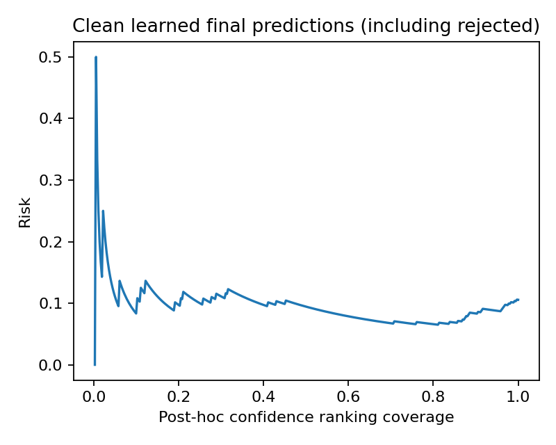
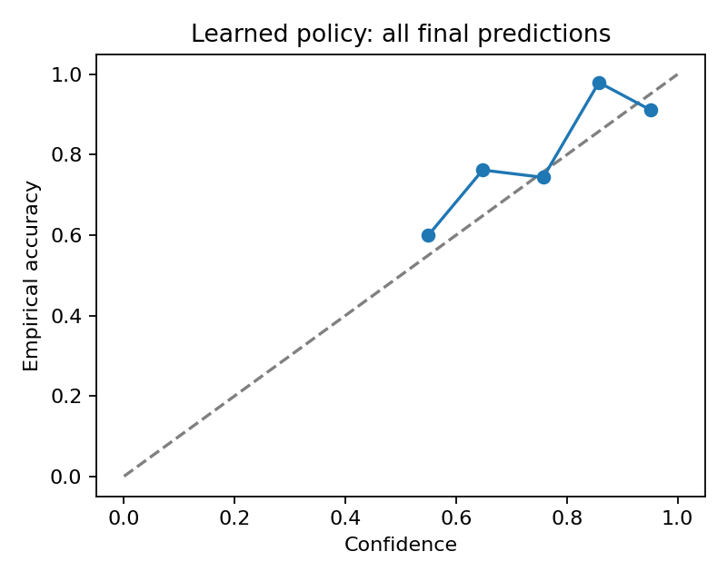

# Saved experiment results

These held-out runs used the saved configuration and seeds 7, 11, and 19 on 24 October 2026. Reproduce them with `python scripts/reproduce_synthetic.py --seeds 7 11 19`; full artifacts go into ignored `runs/` directories.

Start with `seed_summary.json` for means, sample standard deviations, and defined-seed counts across every strategy, budget, and condition. Individual `seed-{seed}-metrics.json` files retain each run's results. Manifests record data hashes, versions, and class counts; `learning_check` files hold the shuffled-label controls. The complete example table is in `seed-7-report.md`.

At budget 1.0, the learned policy averaged 90.70% accepted accuracy at 91.48% coverage and 0.511 cost. The threshold baseline reached 91.66%, 95.56%, and 0.624. Different operating points prevent a fair improvement claim. Costs cover cached features only; three seeds are preliminary.

All 31 tests and three calculated learning controls passed. Independent review led to checkpoint-provenance and optimizer-state fixes, with regression coverage. `verification.txt` records the destination checks. The saved source hashes identify the implementation.
